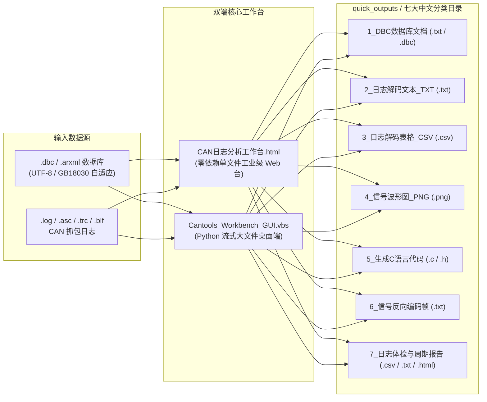

# CAN-Telemetry-Workbench · CAN 总线可视化诊断与开发工作台

> **面向智能汽车、两轮电动车（BMS / VCU / MCU / 仪表）与嵌入式开发的 CAN 总线**  
> 集 **单文件离线 HTML 示波器工作台** + **Python 桌面 GUI** + **DBC 在线可视化编辑** + **故障阈值自动触发** + **嵌入式 C 代码生成器** 于一体。

---

## 一、 为什么做这个项目？（对比原版 `cantools` 的核心升级）

原版 [`cantools`](https://github.com/cantools/cantools) 是一个优秀的 Python 命令行底层库，但在国内实际车载与智能硬件研发场景中存在明显痛点：纯英文命令行门槛高、遇到带中文注释（GBK/GB18030）的 `.dbc` 直接报错、缺乏直观的多通道波形与 64-Bit 位域排布视图、输出文件杂乱。

本项目在底层修复与扩展 `cantools` 的基础上，打造了 **Web 单文件离线版 + Python 桌面原生版** 双端工作台：

| 能力维度 | 原版 `cantools` | 本项目 (`CAN-Telemetry-Workbench`) |
| :--- | :--- | :--- |
| **交互界面** | 纯命令行 CLI | **瑞士暖白工业风单文件 HTML 工作台** + **Tkinter 桌面原生 GUI** |
| **零安装便携性** | 需配置 Python 与十余个依赖库 | 双击 [`CAN日志分析工作台.html`](./CAN日志分析工作台.html) 即可在浏览器离线完成全套分析 |
| **故障阈值自动触发 (绝活 A)** | 无 | 支持设定物理信号阈值规则（如 `Temperature > 258`），**解码表自动标红 + 示波器绘制红色告警线与异常点** |
| **DBC 在线可视化编辑 (绝活 B)** | 仅支持代码级读取 | **64-Bit 彩色矩阵点选拾取起始位**，在线新增/删除报文与信号并一键导出新 `.dbc` 文件 |
| **独立 HTML 诊断报告 (绝活 C)** | 无 | 一键将统计指标、示波器高清波形快照、周期体检表与异常帧打包生成独立可分享的 `.html` 诊断报告 |
| **支持日志格式** | `candump`、PCAN `.trc` | 新增 **Vector `.asc`** 原生解析器、二进制 **`.blf`** 支持，修复紧凑时间戳解析 Bug |
| **中文编码与容错** | 默认严格模式，GBK 中文注释易崩溃 | 自动嗅探 **`UTF-8` / `UTF-8-SIG` / `GB18030` / `GBK` / `CP1252`** 并启用非严格容错加载 |
| **输出文件管理** | 散落在当前目录 | 自动归档至 [`quick_outputs/`](./quick_outputs) 下 **7 大中文分类子文件夹** |

---

## 二、 系统架构与七大分类归档体系



---

## 三、 快速开始（3 种启动方式）

### 方式 1：直接双击打开 `CAN日志分析工作台.html`（最推荐 · 零环境依赖）
1. 用 Edge 或 Chrome 双击根目录下的 **[`CAN日志分析工作台.html`](./CAN日志分析工作台.html)**。
2. 打开即自动加载内置的 `motohawk` + 实车三电（VCU 扭矩控制 `0x108`、BMS 电池状态 `0x214`、诊断帧 `0x7DF`）演示数据。
3. 支持直接将本地 `.dbc` 和 `.log` / `.trc` / `.asc` 文件**拖拽进浏览器窗口**。
4. 点击右上角 **【绑定本地七大分类目录 (quick_outputs)】** 并选择 [`quick_outputs`](./quick_outputs) 文件夹授权后，网页端导出的所有文件将自动创建并写入对应的 7 个中文分类子文件夹。

### 方式 2：双击 `Cantools_Workbench_GUI.vbs`（Python 桌面原生窗口版）
- 无黑框静默启动 Python Tkinter 桌面工作台（[`tools/cantools_gui.py`](./tools/cantools_gui.py)），适合处理百兆级超大日志流式导出 CSV 及二进制 `.blf` 文件。

### 方式 3：命令行批处理 / 脚本调用
```bash
# 启动交互式菜单
Cantools_Quick_Menu.bat --cli

# 运行全套单元测试
pytest tests/test_logreader.py
```

---

## 四、 核心功能一览

1. **`01` 日志解码与故障阈值自动定位（绝活 A）**
   - 顶部工具栏可设置任意信号的故障触发条件（如 `ExampleMessage.Temperature > 258`）。
   - 解码表格自动将触发异常的报文行与信号值**高亮标红**，支持勾选 **“仅看触发异常帧”** 一键筛出故障瞬间。
2. **`02` 日志体检与周期抖动诊断**
   - 自动统计每个 CAN ID 的总帧数、实测平均/最小/最大周期（ms），并与 DBC 定义的 `GenMsgCycleTime` 对比，精准识别通信丢包、周期抖动与未定义“野帧” ID。
3. **`03` 多通道交互式数字示波器**
   - 支持鼠标滚轮缩放时间轴、左键拖拽平移、悬停十字游标精确读数、枚举信号阶梯波绘制，并在波形上同步画出**红色虚线告警阈值线与异常采样点**。
4. **`04` DBC 在线可视化编辑 · 64-Bit 矩阵与嵌入式 C 代码生成（绝活 B）**
   - **8 Byte × 8 Bit（64位）彩色排布图**：直观区分 Motorola (`@0` 大端跨字节) 与 Intel (`@1` 小端) 位域，点击矩阵任意空白格即可自动拾取 `Start Bit` 新增信号或新增报文，并**一键导出修改后的 `.dbc` 文件**。
   - **嵌入式 C 代码生成**：一键将 `.dbc` 转换为符合单片机（STM32 / 英飞凌 / NXP）规范的 `.h` 结构体与 `.c` 位移打包/解包（`pack/unpack`）源码。
5. **`05` 信号反向编码器（台架调试帧合成）**
   - 输入工程物理量（如温度、转速、使能开关），实时计算 `Raw = round((Phys - Offset) / Scale)`，生成 8 字节 Hex、二进制位视图以及 `candump` / `cansend` 注入指令。
6. **一键生成独立 HTML 诊断报告（绝活 C）**
   - 点击顶部 **【一键生成独立 HTML 诊断报告】**，自动将当前工况 KPI、示波器高清波形截图、CAN ID 周期体检表与异常事件表打包成一份独立的 `.html` 报告单，方便直接发给团队或归档。

---

## 五、 开源协议与致谢

本项目基于 [cantools](https://github.com/cantools/cantools) 进行扩展开发，遵循 [MIT License](./LICENSE) 开源协议。
